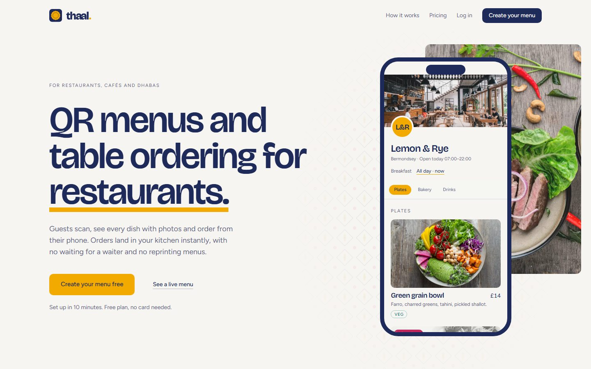
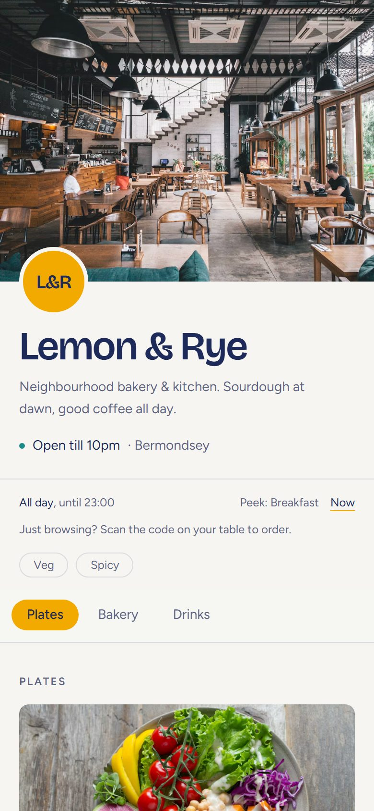
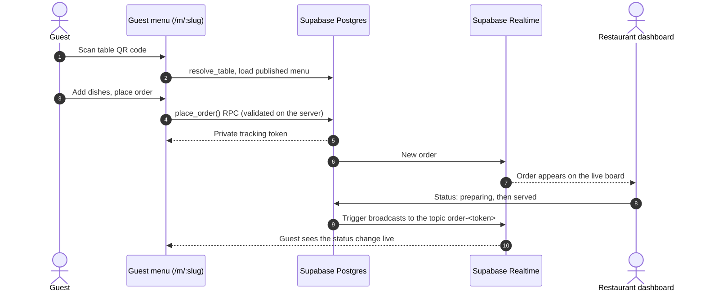

<div align="center">

<picture>
  <source media="(prefers-color-scheme: dark)" srcset="public/brand/thaal-logo-dark.svg">
  
</picture>

### QR code menus and table ordering for restaurants, cafés and dhabas

Guests scan a QR code, browse a photo menu and order from their phone. The order appears in the kitchen dashboard straight away.

[**Live demo**](https://thaal.lovable.app) · [**Sample menu**](https://thaal.lovable.app/m/lemon-and-rye) · [Features](#features) · [How it works](#how-it-works) · [Tech stack](#tech-stack) · [Run locally](#run-locally)


</div>

<br>

<table>
  <tr>
    <td width="76%" valign="top"></td>
    <td width="24%" valign="top"></td>
  </tr>
  <tr>
    <td align="center"><sub>Landing page</sub></td>
    <td align="center"><sub>Guest menu on a phone</sub></td>
  </tr>
</table>

## What Thaal does

**Thaal** is a digital menu and table-ordering system for restaurants. An owner builds a menu with dish photos, chooses a theme and prints a branded QR code for each table. Guests scan the code, browse the menu and order without installing an app or creating an account. Orders arrive in the restaurant's dashboard in real time, and guests watch their order status update live on their phone.

## Features

<table>
  <tr>
    <th align="left" width="50%">For restaurant owners</th>
    <th align="left" width="50%">For guests</th>
  </tr>
  <tr valign="top">
    <td>

- Sign-up and guided onboarding
- Menu builder with categories, drag-to-reorder and image upload with cropping
- Theme and design customisation for the public menu
- Branded QR codes for each table, exported as a PNG/SVG zip or a printable A4 PDF
- Live order board, plus "call waiter" and "bring the bill" requests
- Reviews, analytics and multiple branches
- Free, Pro and Business plans with feature gating

</td>
    <td>

- A public menu page for each restaurant at `/m/:slug`, optionally linked to a table
- Cart, ordering and live order status with no account
- Opening hours and scheduled menus such as breakfast and all-day
- Dietary filters and dish reviews
- Installable as a progressive web app (PWA) with an offline page

</td>
  </tr>
</table>

## How it works



## Security design

- **Guests never read the orders table.** They place and track orders through `SECURITY DEFINER` Postgres functions (`place_order`, `get_order_status`) that check a private tracking token for each order.
- **Live status updates are private.** A database trigger sends each status change to a Realtime topic named after that order's token, so one guest can't subscribe to another guest's order.
- **Users can't upgrade their own plan.** A trigger (`guard_restaurant_billing`) means only the service role can write billing and plan fields.
- **Storage access is scoped per restaurant.** Uploaded media paths are keyed by restaurant, so storage policies can limit who reads and writes them.
- **Anonymous access is locked down.** Anonymous visitors can read only menu data and a column-limited view of each restaurant, so billing columns are never exposed. Each table can send only one waiter or bill request of each type every 60 seconds.

## Plans

| Plan | Price | Includes |
| :-- | :-- | :-- |
| **Free** | £0 | 1 menu, unlimited dishes and photos, one plain QR code, browse-only menu |
| **Pro** | £19/month | Unlimited menus, table ordering, custom themes, branded table QR codes, analytics |
| **Business** | £49/month | Everything in Pro, plus multiple branches |

Plan limits are defined in one place, `src/lib/plan.ts`, and both the landing page and the billing page read from it.

## Tech stack

| Layer | Technologies |
| :-- | :-- |
| Frontend | React, TypeScript, TanStack Start and Router, Tailwind CSS, Framer Motion, dnd-kit |
| Backend | Supabase: Auth, Postgres with Row Level Security, Realtime, Storage |
| Database | 7 Drizzle migrations, SQL functions and triggers |
| QR and export | qr-code-styling, JSZip, jsPDF |
| Quality | Vitest (45 unit tests across 12 files), ESLint, Prettier |

## Run locally

```sh
npm install
npm run dev
```

| Script | What it does |
| :-- | :-- |
| `npm run dev` | Start the dev server |
| `npm run build` | Production build |
| `npm test` | Run the unit tests |
| `npm run lint` | Lint the project |

The committed `.env` holds only the project's public Supabase URL and publishable key, so a local run connects to the hosted backend. To run it on its own, point those values at your own Supabase project. Never commit service-role keys.

## Project structure

```text
src/
├── routes/                  File-based routes
│   ├── m/$slug.tsx          Public guest menu
│   └── _authenticated/
│       └── dashboard/       Owner app: menu, orders, QR, design, analytics, billing
├── components/
│   ├── menu/                Guest menu, cart and order status
│   ├── dashboard/           Menu builder, hours editor, QR preview
│   └── landing/             Marketing site
└── lib/
    ├── menu/                Cart, hours and scheduling logic (tested)
    ├── qr/                  QR rendering and table codes (tested)
    └── plan.ts              Plan limits and pricing (tested)
drizzle/migrations/          Schema, RLS policies, RPCs and triggers
```

Design colours come from tokens in `src/styles.css`, and `AGENTS.md` records the project's design rules.

## Status

Live and actively developed. No license has been specified yet, so all rights are reserved by the author.

## About the author

Thaal is designed and built by **[Rumman Hassan](https://rummanhassan.cv)**, a full-stack developer in Lahore, Pakistan. Rumman builds web apps, ecommerce stores and AI systems for growing businesses.

It was built with AI assistance using [Lovable](https://lovable.dev). Rumman owns the product, the data model and the security design, and changes made in the Lovable editor are committed to this repository.

[Website](https://rummanhassan.cv) · [GitHub](https://github.com/rummanhassan13) · [LinkedIn](https://www.linkedin.com/in/rummanhassan13) · [Work with me](https://cal.com/rummanbuilds/connect)
